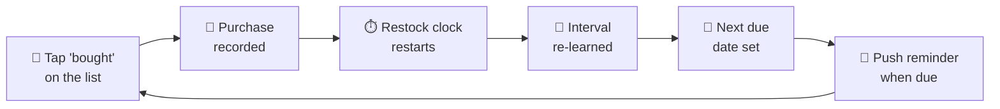
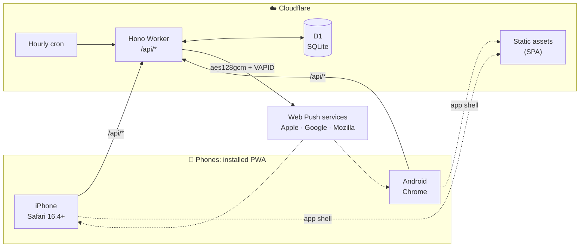

<div align="center">


# Pantry

### The grocery list that learns when you'll run out.

A shared restock app for a household. Pantry learns how fast you use each staple, reminds you
before it runs out, and keeps one shopping list in sync on every phone, including offline in the shop.

[](LICENSE)
[](#-testing)
[](tsconfig.json)
[](https://developers.cloudflare.com/workers/)
[](https://react.dev)
[](#-deployment)

[**Features**](#-features) · [**How it works**](#-how-it-works) · [**Quick start**](#-quick-start) · [**Deployment**](#-deployment) · [**API**](#-api-reference) · [**Design doc**](docs/DESIGN.md)

<br />

| Today | Shopping List | Inventory | Stats |
| :---: | :---: | :---: | :---: |
|  |  |  |  |

</div>

---

## Table of contents

- [Overview](#-overview)
- [Features](#-features)
- [How it works](#-how-it-works)
- [Architecture](#-architecture)
- [Tech stack](#-tech-stack)
- [Quick start](#-quick-start)
- [Configuration](#-configuration)
- [Deployment](#-deployment)
- [Testing](#-testing)
- [API reference](#-api-reference)
- [Project structure](#-project-structure)
- [Security](#-security)
- [Known limitations and roadmap](#-known-limitations-and-roadmap)
- [Documentation](#-documentation)
- [Credits and license](#-credits-and-license)

---

## 🧭 Overview

Most grocery apps are lists you have to keep up to date by hand. Pantry is built around
one rule:

> [!IMPORTANT]
> **Ticking an item off the list is the only data entry.**
> There is no separate "log what you used" step, because people stop doing that within a week.

That one tap records a purchase. From the purchase history, Pantry learns each item's
restock interval, works out when the item will next be due, and sends a push reminder
to each household member at a time that suits them. Every reminder, chart and history
entry is read from those same purchase records.

|   | |
|---|---|
| **Who it's for** | A household of two or more sharing one grocery run, on iPhone and Android |
| **Delivery** | Installable Progressive Web App, with no app store needed |
| **Hosting** | Cloudflare Workers and D1. A household fits comfortably in the free tier. |
| **Currency** | Bangladeshi Taka (৳), stored as integer poisha |

---

## ✨ Features

<table>
<tr>
<td width="50%" valign="top">

#### 🧠 Learns your rhythm
Each item gets a restock interval learned from the **median** gap between real purchases.
One bulk buy or one missed week doesn't throw it off.

#### 🔔 Reminds you at the right time
Each person gets a push digest at their own hour, on their own days, in their own
timezone and outside their own quiet hours.

#### 🛒 One shared list
Anyone can add to it. Everyone else is told when something is added or bought, and a
whole shop is rolled into one running notification.

#### 🏬 Shop Mode
A full-screen store view in aisle order, with large tap targets, an optional price per
item and a running total. The screen stays awake.

</td>
<td width="50%" valign="top">

#### 📶 Works without signal
The app shell is cached and recent data is kept on the device. Actions taken offline are
queued and replayed in order when the connection returns.

#### 📊 Spending insights
Spending by category and by day, week or month, plus how fast each item is used. A
receipt total can be split across the items it paid for.

#### 🧾 Bills, kept apart
Gas, electricity and wifi have their own screen. They are paid up front, so they never
count towards spending or the month's grocery bill. The gas cylinder has no due date,
because it lasts as long as it lasts.

#### 🥫 Product icons and audit trail
Every item gets a monochrome icon picked from its name ("Masoor Dal" and "moong dal"
both show lentils). Every past shop can be corrected afterwards, and every deletion is
recorded in an append-only log.

</td>
</tr>
</table>

---

## ⚙️ How it works

### The core loop



### Restock status

| Status | Meaning |
|---|---|
| 🟢 `ok` | Well within its interval |
| 🟡 `due_soon` | Within the member's lead time of the interval |
| 🟠 `due` | The interval has passed |
| 🔴 `overdue` | One and a half intervals have passed |

### Interval learning

After each purchase, the interval is recalculated as the **median gap between purchases**:

- It needs **at least three purchases** before it learns anything.
- It is **clamped to 1–365 days**.
- A new interval is adopted only if it moves the interval by **more than 20%**, so normal
  week-to-week noise doesn't make it churn.
- Any interval can be **locked by hand**. A wifi bill, for example, stays at 30 days
  even when it is paid late.

### Money model

All prices are stored as integers in minor units (poisha), never as floats. Everything
that isn't a utility counts as groceries. A month's groceries form **one bill, settled
the following month**, like a credit-card statement. Utilities are paid up front and
stay out of every spending figure. They appear only on the Bills screen, next to the
grocery bill and never inside it.

---

## 🏗️ Architecture



### Reliability guarantees

Where a silent failure would corrupt data, the guard lives in the database and not only
in application code.

| Guarantee | How it's enforced |
|---|---|
| **Buying is idempotent** | Each write in the buy transaction is conditional on the list entry still being `pending`, and the status flip runs last. A double-tap, a retry or a replayed offline action records exactly one purchase. |
| **No duplicates on the list** | Partial unique indexes stop the same item, or the same free-text name in any letter case, from being on the list twice. Item names are unique regardless of case. |
| **Offline purchases keep their real time** | A purchase is timestamped when it is tapped, not when it syncs, so learned intervals aren't skewed by when the signal came back. |
| **One bad record can't silence the household** | Each push subscription, and each member in the reminder sweep, is handled in isolation. |
| **Deletions leave a trace** | Deleting an item saves a snapshot of it and its purchase history to the audit log, in the same transaction as the delete. |

> [!NOTE]
> Push uses the `aes128gcm` encoding only. iOS rejects the older `aesgcm` encoding **without
> any error**, so a library that uses it works on Android and quietly does nothing on iPhone.
> `test/push-encryption.test.ts` decrypts real payloads with a separate RFC 8291
> implementation to catch this. See [AGENTS.md](AGENTS.md#web-push-read-this-before-changing-anything-about-notifications).

---

## 🧰 Tech stack

| Layer | Choice |
|---|---|
| **Runtime** | Cloudflare Workers |
| **API** | Hono 4 |
| **Database** | Cloudflare D1 (SQLite), with 12 versioned migrations |
| **Client** | React 19, TypeScript, Vite, Tailwind CSS 4, styled to Apple's iOS Human Interface Guidelines |
| **Push** | Web Push via `web-push-neo` (`aes128gcm` with VAPID) |
| **Tests** | Vitest 4 with `@cloudflare/vitest-pool-workers`, running a real Worker against a real D1 |

There are **four runtime dependencies**: `hono`, `react`, `react-dom` and `web-push-neo`.
The app uses no chart, component, state-management or date library.

---

## 🚀 Quick start

**You need:** Node.js 22+ and a Cloudflare account (the free tier is enough).

```bash
# 1. Install dependencies
npm install

# 2. Set up local secrets (see Configuration below)
cp .dev.vars.example .dev.vars

# 3. Create the local database
npm run db:migrate:local
```

Run the Worker and the client in **two terminals**:

```bash
npm run dev:worker   # API and local D1 on http://localhost:8787
npm run dev          # Vite client on http://localhost:5173, proxying /api to the Worker
```

Open **http://localhost:5173**. The first run walks you through setting up the household.

> [!TIP]
> Local D1 state lives in `.wrangler/state/v3/d1`. Delete that folder to start over with
> an empty database.

### Commands

| Command | What it does |
|---|---|
| `npm test` | Run the full test suite |
| `npm run test:watch` | Run tests in watch mode |
| `npm run typecheck` | `tsc --noEmit` |
| `npm run build` | Production build |
| `npm run deploy` | Build and deploy to Cloudflare |
| `npm run db:migrate:local` | Apply migrations to the local database |
| `npm run db:migrate:remote` | Apply migrations to the production database |
| `npx wrangler types` | Regenerate binding types after editing `wrangler.jsonc` |
| `node scripts/render-icons.mjs` | Re-render the app icons from `scripts/icons/` |
| `node scripts/product-icons.mjs` | Rebuild the bundled product icons after changing `src/client/lib/productIcon.ts` |

---

## 🔧 Configuration

| Variable | Purpose |
|---|---|
| `SESSION_SECRET` | Signs session cookies. Generate one with `openssl rand -base64 32`. |
| `VAPID_PUBLIC_KEY` / `VAPID_PRIVATE_KEY` | The Web Push key pair. Generate it once with `web-push-neo`. |
| `VAPID_SUBJECT` | A `mailto:` contact address for push services |

Use `.dev.vars` locally (it is git-ignored). In production, use `npx wrangler secret put <NAME>`.

> [!WARNING]
> **Keep the VAPID key pair for good.** Rotating it invalidates every phone's push
> subscription, and each person would have to subscribe again.

---

## ☁️ Deployment

```bash
npx wrangler login
npx wrangler d1 create pantry-db       # put the returned database_id in wrangler.jsonc
npm run db:migrate:remote
npx wrangler secret put SESSION_SECRET  # repeat for the three VAPID_* secrets
npm run deploy
```

> [!IMPORTANT]
> On iPhone, notifications work only after the app is **added to the Home Screen**
> (iOS 16.4 or later).

**Cost:** two users fit well within the free tier. Expect about 24 cron runs and a few
dozen requests a day, against free limits of 100k Worker requests a day and 5M D1 row
reads a day.

The full step-by-step guide, including how to check that push really works, is in
[docs/DEPLOYMENT.md](docs/DEPLOYMENT.md).

---

## 🧪 Testing

```bash
npm test && npm run typecheck
```

```text
 Test Files  21 passed (21)
      Tests  308 passed (308)
```

The tests run inside a **real Worker runtime against a real D1 database**, not mocks.
Each test file gets its own isolated database. Coverage includes:

- **Restock engine:** status thresholds, median learning, the 20% guard and timezone helpers
- **Idempotency:** double-taps, retries and replayed offline purchases
- **Household isolation:** no query reaches outside its household
- **Push:** round-trip decryption with a separate RFC 8291 implementation, plus pruning of dead subscriptions
- **Offline sync:** outbox ordering and replay
- **Money and bills:** integer arithmetic, and utilities kept out of spending

---

## 📡 API reference

Every route is under `/api` and returns JSON. Errors have one shape:

```json
{ "error": "snake_case_code", "message": "Human-readable sentence." }
```

*Session* means a signed-in device. *Member* means a profile has also been chosen, which
any action attributed to a person requires.

<details>
<summary><b>Show all endpoints</b></summary>
<br />

| Method | Path | Requires |
|---|---|---|
| `GET` | `/session` | none |
| `POST` | `/setup` | none (first run only) |
| `POST` | `/login` · `/logout` | none |
| `POST` | `/profile` | session |
| `POST` | `/profile/passcode` | member |
| `GET` | `/items` · `/categories` | session |
| `GET` | `/today` | member |
| `POST` | `/items` | member |
| `PATCH` | `/items/:id` | session |
| `DELETE` | `/items/:id` | member |
| `GET` | `/list` | session |
| `POST` | `/list` | member |
| `PATCH` | `/list/:id` | session |
| `DELETE` | `/list/:id` | member |
| `POST` | `/list/:id/skip` | session |
| `POST` | `/list/:id/bought` | member |
| `GET` | `/purchases` · `/items/:id/purchases` | session |
| `POST` · `PATCH` | `/purchases` | member |
| `DELETE` | `/purchases/:id` | member |
| `GET` | `/insights` · `/audit-log` | session |
| `GET` | `/push/key` | none |
| `POST` | `/push/subscribe` · `/push/test` | member |
| `GET` | `/health` | none |

</details>

---

## 🗂️ Project structure

```text
pantry/
├── migrations/            D1 schema and migrations (0001_init.sql is the annotated baseline)
├── public/                PWA manifest, icons and service worker
├── scripts/               Icon sources and renderers
├── src/
│   ├── shared/types.ts    Types shared by the Worker and the client
│   ├── worker/
│   │   ├── index.ts       App assembly, fetch and scheduled handlers
│   │   ├── restock.ts     Restock status, interval learning, local-time helpers
│   │   ├── cron.ts        Hourly reminder digest
│   │   ├── activity.ts    Notifications for list adds and purchases
│   │   ├── push.ts        Web Push delivery and dead-subscription pruning
│   │   ├── audit.ts       Audit-log writer
│   │   ├── auth.ts        Passcode hashing and signed sessions
│   │   └── routes/        auth, items, list, purchases, insights, push, audit
│   └── client/
│       ├── screens/       Today, Shopping List, Shop Mode, Inventory, Stats, History, Bills, Settings
│       ├── components/    Sheets, tab bar, jars, offline outbox, banners
│       └── lib/           Money, offline queue and cache, date grouping, formatting
├── test/                  One file per area, each against an isolated D1
└── docs/                  Design rationale, deployment guide, progress log
```

---

## 🔒 Security

| Area | Approach |
|---|---|
| **Authentication** | No user accounts. A household shares one passcode, hashed with **PBKDF2-SHA256 at 100,000 iterations** (the most Workers allows) and a random salt. The owner's profile can have a second passcode of its own. |
| **Sessions** | HMAC-signed `HttpOnly` cookies |
| **Data isolation** | Every query is scoped to the household and uses bound parameters |
| **Secrets** | Never committed. `.dev.vars` is git-ignored, and production secrets live in Wrangler's secret store. |

---

## 🛣️ Known limitations and roadmap

- [ ] Edit reminder settings (hour, days, quiet hours, lead time) in the app. They are honoured but can't yet be changed there.
- [ ] Edit categories and aisle order in the app. They are set during setup.
- [ ] Configurable currency. It is fixed to ৳ (BDT).
- [ ] More than one household per deployment

---

## 📚 Documentation

| Document | What's inside |
|---|---|
| [docs/DESIGN.md](docs/DESIGN.md) | The problem, design decisions and rejected alternatives, the restock engine, the money model and the data model |
| [docs/DEPLOYMENT.md](docs/DEPLOYMENT.md) | Step-by-step production setup, installing on phones, checking push, cron and cost |
| [docs/PROGRESS.md](docs/PROGRESS.md) | Development log |
| [AGENTS.md](AGENTS.md) | Conventions, invariants and lessons learned, for contributors and AI agents |

---

## 🙏 Credits and license

Designed and built by **Mahmudul Khan** · [mahmudulkhan.com](https://www.mahmudulkhan.com)

Product icons are from [Fluent Emoji High Contrast](https://github.com/microsoft/fluentui-emoji)
by Microsoft, used under the MIT License.

Released under the [MIT License](LICENSE).

<div align="center">
<sub>Built for the weekly shop, so nobody gets home without the rice.</sub>
</div>
