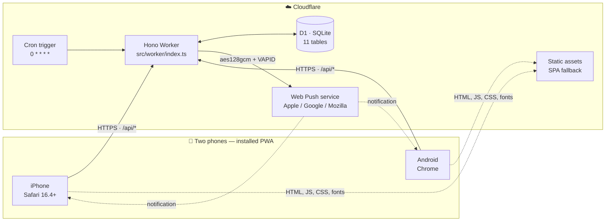
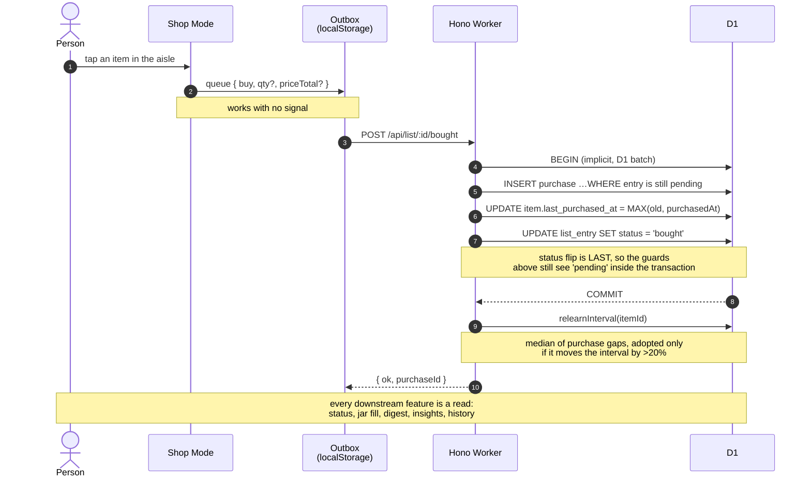
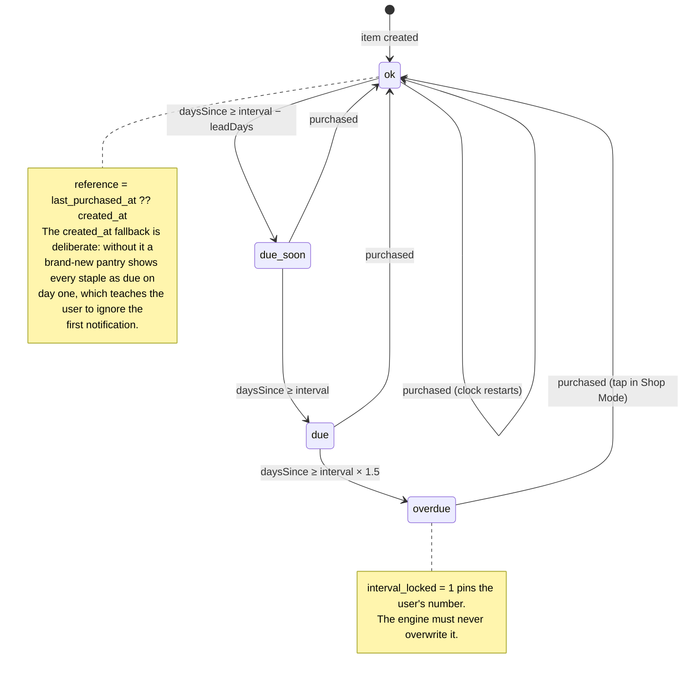
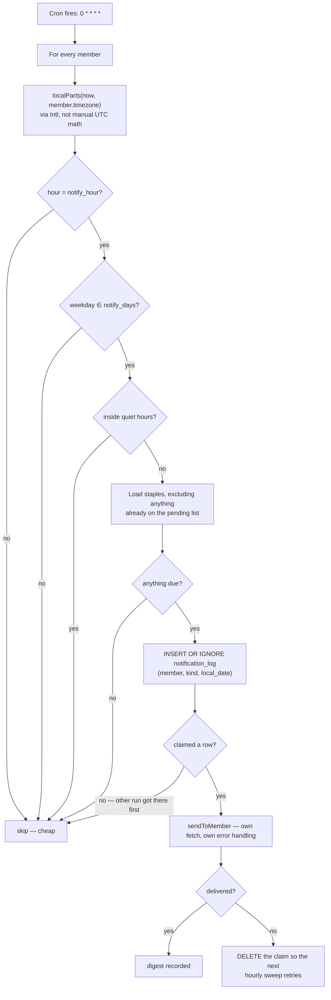
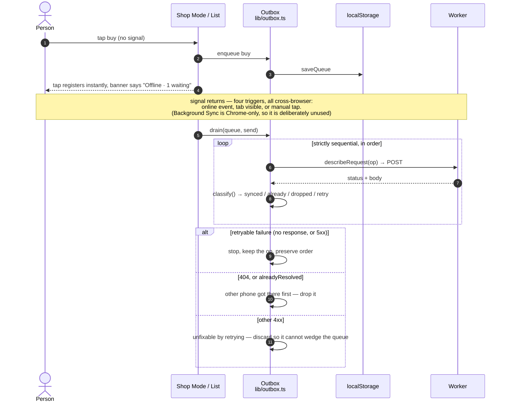
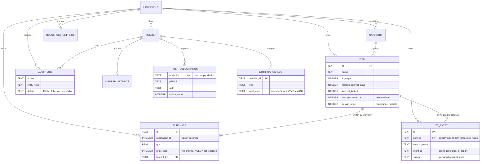
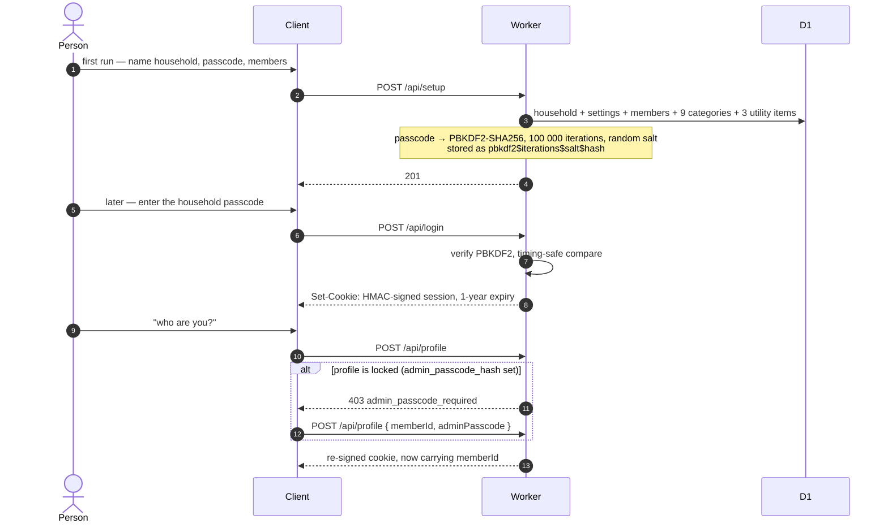
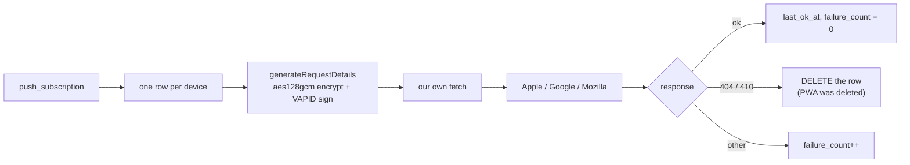

# Pantry

Smart weekly grocery restock for a two-person household. Knows what is running low, when
it is due, and what to buy next — without anyone maintaining a separate consumption log.

Two phones (iPhone + Android), one shared list, one tap to buy.



---

## The one idea that explains everything

**Ticking an item off the shop list is the only data entry in the system.** There is no
separate "log your consumption" step, because that is a chore people abandon after a
week. That single tap writes a `purchase` row, and every other feature is a read of that
row.



Because the buy is idempotent, the same request replayed from the offline queue — or
double-tapped in Shop Mode, or retried on flaky shop wifi — writes exactly one purchase
row. That matters more than it looks: a duplicate purchase silently corrupts both the
learned interval and the spend totals, and nothing downstream can tell it apart from
genuinely buying rice twice.

---

## Features

| | |
|---|---|
| **Auto-learning intervals** | Median of purchase gaps, with a 20% stability guard. Refines the longer you use it. |
| **Per-member notifications** | The digest is gated per person on their own notify hour, weekdays, timezone, lead time, and quiet hours. The columns are seeded and read by the cron, but there is no API or screen to edit them yet — see *Known gaps*. |
| **Shop Mode** | Immersive full-screen store view: aisle order, big tap targets, optional price entry, running total, Wake Lock, offline queueing. |
| **Jars on shelves** | The Pantry screen draws each item as a jar that empties over its restock cycle. Costs no extra request — it is arithmetic over fields already fetched. |
| **Bills** | Gas, electricity and wifi are ordinary items with their own screen and month-grouped log, kept out of the grocery screens. |
| **Receipt splitting** | Log a shop's total and split it across the items bought, pinned amounts first, remainder distributed. |
| **History & audit** | Date-grouped shopping history; an immutable system log of every deletion, readable in-app. |
| **Insights** | Consumption rhythm, spend by category, month/week/day spend buckets, price trends. All from existing `purchase` rows. |
| **Works offline** | Cached app shell, last-known-good data snapshots, and a durable write queue that replays in order. |
| **PWA** | Installable on both phones, Web Push without a native app. |

---

## Screens

| Today | Shop list | Shop Mode |
|---|---|---|
| What's due, most urgent first. One tap adds it to the list. | The shared next-visit list, in aisle order. Either person adds. | The store view. Big targets, running total, screen kept awake. |

| Pantry (jars) | Bills | Insights |
|---|---|---|
| Every item as a jar, emptying as its cycle runs down. | Gas, electricity, wifi, with a month-grouped payment log. | Rhythm, spend by category, spend over time. |

| History | Settings | |
|---|---|---|
| Every shop, grouped by day, correctable after the fact. | Profile, profile lock, push enablement, theme, audit log. | |

### Screenshots

| Home page | Insights |
|---|---|
|  |  |

---

## The restock engine

`src/worker/restock.ts` is split deliberately: status and interval math are **pure
functions** (exhaustively unit-testable with no D1), and only `relearnInterval` touches
the database.



| Status | Condition (where `daysSince = ⌊(now − reference) / 86400⌋`) |
|---|---|
| `overdue` | `daysSince ≥ interval × 1.5` |
| `due` | `daysSince ≥ interval` |
| `due_soon` | `daysSince ≥ interval − leadDays` |
| `ok` | otherwise |

**Learning.** After each purchase, take the **median** gap between consecutive purchases
(needs ≥ 3 purchases, so ≥ 2 gaps), round, clamp to `[1, 365]`, and adopt it **only if it
differs from the current interval by more than 20%**.

- *Median, not mean* — one bulk buy before guests, or one skipped trip during a holiday,
  produces a single wild gap. A mean chases it; the median shrugs it off.
- *The 20% guard* — a household's real rhythm is noisy. Without it the interval churns by
  a day or two after almost every shop, which makes it meaningless as a signal.
- *`interval_locked`* — the per-item escape hatch, and the reason a fixed 30-day wifi
  bill stays 30 days even if you pay it late.

### The hourly digest



Four things about that loop are load-bearing:

1. **The digest excludes anything already on the pending list.** Nagging about something
   already handled is how you train someone to ignore notifications.
2. **The `notification_log` row is claimed before sending, not after.** Writing it
   afterwards is check-then-act across an `await`: two overlapping cron runs would both
   find no row, both push, and the loser's `INSERT` would throw a UNIQUE error from
   outside the `try` below — ending the sweep, so every member after it silently gets
   nothing. `INSERT OR IGNORE` plus `meta.changes` lets the index decide the race, and
   only the winner sends.
3. **A failed send releases the claim**, so a digest that never arrived is retried rather
   than recorded as sent.
4. **Each member is guarded individually.** One member's delivery blowing up must not
   abort the sweep for the rest of the household.

Local time comes from `Intl.DateTimeFormat` + `formatToParts`, never manual UTC-offset
arithmetic — that breaks twice a year on DST.

---

## Offline: shops are where phones lose signal



The rules live in pure functions over a plain array (`classify`, `describeRequest`,
`drain`) with the sender injected, so the whole queue is testable without a browser.

**Replay safety is the server's doing, not the client's.** `POST /list/:id/bought`
no-ops and reports `alreadyResolved`; `POST /list` matches on a client-generated
`client_id` and returns the existing row; duplicate pending entries are impossible
because unique partial indexes — not application checks — decide the race.

`purchasedAt` is stamped **client-side at tap time**, then clamped server-side to
"never in the future, never more than 30 days back". Stamping it with the server clock at
sync time would tell the engine the shop happened when the wifi came back, dragging every
learned interval along with it.

The service worker deliberately does **not** cache the API. A stale list served silently
from a cache is worse than a failed request the app can see: the app falls back to its own
snapshot and can then say the data is stale.

---

## Data model

`migrations/0001_init.sql` is authoritative and heavily commented. Ten migrations total.



Notable decisions:

- **`item.last_purchased_at` is denormalised** from the newest purchase, so the hourly
  cron does one indexed scan (`idx_item_due`) instead of a per-item aggregate.
- **`list_entry` has a CHECK** enforcing exactly one of `item_id` / `custom_name`, so it
  is either a known pantry item or free text someone typed.
- **Three partial unique indexes** make duplicate pending entries impossible rather than
  unlikely: `idx_list_unique_pending_item`, `idx_list_unique_pending_name` (case-folded —
  "Rice" and "rice" are the same thing), and `idx_list_client_id`.
- **`notification_log`** carries a unique index on `(member_id, kind, local_date)`. That
  index is the whole concurrency control for the digest.
- **`audit_log` has no foreign key on `entity_id`**, so the log outlives the row it
  describes, and the API exposes no delete or update route for it.
- **Items are hard-deleted**, not archived. Deleting cascades to purchases — the audit log
  is what remains.

---

## Auth

There are no user accounts. One household shares a passcode; each device then picks which
member is holding it, and the session cookie carries both.



Two levels of gate: the household passcode gets you in, and a profile lock (set by the
superadmin, on their own profile only) means knowing the household code is not enough to
act as them. Switching *away* from a locked profile is always free.

> **PBKDF2 is capped at 100 000 iterations on Workers.** Exceeding it throws
> `NotSupportedError` at runtime — but the local `workerd` used by vitest does *not*
> enforce the cap, so 210k passes every test and then 500s on every signup and login in
> production. OWASP would ask for more; the platform will not give it. Asserted by a test.

---

## Web Push

**Use `aes128gcm`. Never `aesgcm`.**

Safari's web push shipped in 2023, six years after RFC 8291, and only ever implemented
the modern `aes128gcm` encoding with the RFC 8292 `Authorization: vapid t=..., k=...`
scheme. Chrome and Firefox still accept the older `aesgcm` draft. That asymmetry is a
trap: a library using the legacy encoding works perfectly on Android and **silently does
nothing on iPhone** — the push service accepts the request and the browser discards it.
There is no error anywhere.

| Library | Encoding | Verdict |
|---|---|---|
| `web-push` (6.2M/wk) | — | Node-only (`node:crypto` ECDH, `https.request`). Will not run on Workers. |
| `@block65/webcrypto-web-push` | `aesgcm` | Silently fails on iOS. |
| `webpush-webcrypto` | `aesgcm` | Same, plus ships no types. |
| **`web-push-neo`** | **`aes128gcm` only** | **In use.** No legacy code paths. |

Firebase/FCM was considered and rejected: the send side still requires signing an RS256
service-account JWT in the Worker, so it removes no crypto while adding ~100KB of client
SDK and a Google dependency.

`src/worker/push.ts` uses `generateRequestDetails` + its own `fetch` rather than the
library's `sendNotification`, so failure handling is ours and tests can stub
`globalThis.fetch`. Encryption sits **inside** the per-subscription try/catch: a corrupt
`p256dh` used to throw out of `sendToMember`, past the sweep, and stop every remaining
member from being notified.



`test/push-encryption.test.ts` stands up a fake browser subscription, has the library
encrypt to it, then decrypts the result with an **independent** RFC 8291 implementation
and asserts the plaintext round-trips. It is the only cheap place to catch a miscrypted
push, because in production the failure is completely silent.

---

## Tech stack

| Layer | Choice |
|---|---|
| Runtime | Cloudflare Workers |
| Routing | Hono 4 |
| Database | Cloudflare D1 (SQLite) |
| Client | Vite 8 + React 19 + TypeScript 5.9 + Tailwind 4 (CSS-first config) |
| Fonts | Self-hosted Hanken Grotesk + Source Serif 4, variable, Latin subset |
| Push | `web-push-neo` (`aes128gcm` only) |
| Tests | Vitest 4 + `@cloudflare/vitest-pool-workers` — real Worker, real D1 |

No chart library, no component library, no state manager, no date library. The
dependencies are 4 runtime ones.

---

## API

All routes are under `/api`. `requireSession` = logged-in device. `requireMember` = a
profile is also chosen, which is needed for attribution.

| Method | Path | Guard |
|---|---|---|
| GET | `/session` | — |
| POST | `/setup` | — (first run only) |
| POST | `/login` | — |
| POST | `/profile` | session |
| POST | `/profile/passcode` | member |
| POST | `/logout` | — |
| GET | `/items` | session |
| GET | `/today` | member |
| GET | `/categories` | session |
| POST | `/items` | member |
| PATCH | `/items/:id` | session |
| DELETE | `/items/:id` | session |
| GET | `/list` | session |
| POST | `/list` | member |
| PATCH | `/list/:id` | session |
| DELETE | `/list/:id` | session |
| POST | `/list/:id/skip` | session |
| POST | `/list/:id/bought` | member |
| GET | `/purchases` | session |
| POST | `/purchases` | member |
| PATCH | `/purchases` | member |
| DELETE | `/purchases/:id` | member |
| GET | `/items/:id/purchases` | session |
| GET | `/insights` | session |
| GET | `/audit-log` | session |
| GET | `/push/key` | — |
| POST | `/push/subscribe` | member |
| POST | `/push/test` | member |
| GET | `/health` | — |

Errors are always `{ error: "snake_case_code", message: "Human sentence." }`.

---

## Conventions

- **Timestamps are unix epoch seconds** (INTEGER), so day math is `(b − a) / 86400`.
- **Money is integer minor units** (poisha/cents). Never a float. `price_total` is
  nullable — a purchase with no recorded price is normal and expected, and is distinct
  from a price of zero.
- **Booleans are INTEGER 0/1** in SQL, real booleans in the API layer.
- **Ids are `crypto.randomUUID()` TEXT.**
- **SQL columns are `snake_case`; API JSON is `camelCase`.** Route files own the mapping
  (`toListEntry`, `toPurchase`, `toItemWithStatus`).

---

## Invariants

These are tested, and breaking them causes silent data corruption:

1. **Every query must be scoped by `household_id`.** No exceptions.
2. **Always use bound parameters.** Never interpolate a value into SQL.
3. **Buying must stay idempotent.** Every write in `POST /list/:id/bought` is guarded by
   `EXISTS (… status = 'pending')`, and the status flip is ordered **last** so the guards
   still see `pending` inside D1's batch transaction.
4. **Never let one bad row silence the household.** Push encryption is inside the
   per-subscription try/catch, and the cron loop guards each member.
5. **`interval_locked = 1` means the engine must never touch that item's interval.**
6. **Duplicate pending list entries are impossible, not just unlikely** — enforced by
   partial unique indexes, not by application checks.

---

## Development

Node is installed via nvm and is **not on the default PATH**. Every command must be
prefixed:

```bash
export PATH="$HOME/.nvm/versions/node/v22.23.0/bin:$PATH"
```

```bash
npm install
npm run dev              # Vite client, proxies /api to wrangler dev on :8787
npm run dev:worker       # wrangler dev — Worker + local D1
npm test                 # full suite (276 tests, 18 files)
npm run typecheck        # tsc --noEmit
npm run build
npm run db:migrate:local
npm run deploy
npx wrangler types       # regenerate worker-configuration.d.ts after editing bindings
```

`npm run dev` only runs the client. Run `npm run dev:worker` in a second terminal as
well, or every API call will fail.

### Environment

Copy `.dev.vars.example` to `.dev.vars` (gitignored) for local dev, or use
`npx wrangler secret put` for production:

```
SESSION_SECRET=<openssl rand -base64 32>
VAPID_PUBLIC_KEY=<from web-push-neo generateVAPIDKeys>
VAPID_PRIVATE_KEY=<from web-push-neo generateVAPIDKeys>
VAPID_SUBJECT=mailto:you@example.com
```

> **Keep the VAPID pair forever.** Rotating it invalidates every existing subscription and
> both phones have to re-subscribe.

### Tests

18 files, 276 tests. Declared `it()` / `test()` blocks per file:

```
test/admin.test.ts           22    test/outbox.test.ts            27
test/audit.test.ts            5    test/push-encryption.test.ts    4
test/auth.test.ts            18    test/push-routes.test.ts        9
test/cron.test.ts            13    test/restock.test.ts           24
test/history.test.ts          8    test/utilities-lib.test.ts     20
test/insights.test.ts        12    test/utilities.test.ts         16
test/items.test.ts           20    test/jar.test.ts                8
test/list.test.ts            25    test/money.test.ts             19
test/offline-sync.test.ts    12    test/numbers.test.ts           10
```

Each file gets its own isolated D1, with migrations applied from `migrations/` at config
time. Local D1 state lives in `.wrangler/state/v3/d1`; delete it to reset.

Production bundle: **343 KB JS (96 KB gzip)**, 48 KB CSS (10 KB gzip).

---

## Project structure

```
migrations/              10 D1 migrations, 0001_init.sql authoritative and commented
src/
  shared/
    types.ts             Types shared by Worker and client. No runtime imports.
  worker/
    index.ts             Hono app assembly + fetch/scheduled handlers
    env.ts               Env bindings, nowSeconds(), isSecureRequest()
    auth.ts              PBKDF2 hashing, HMAC session tokens, timing-safe compare
    middleware.ts        loadSession / requireSession / requireMember
    restock.ts           The engine: status, median learning, timezone helpers
    push.ts              Web Push delivery + dead-subscription pruning
    cron.ts              Hourly digest sweep
    routes/              auth, items, list, purchases, insights, push, audit
  client/
    App.tsx              App root, boot sequence, router, providers
    api.ts               Typed API client — one function per endpoint
    components/          22 components: sheets, badges, jars, outbox, banners
    hooks/               useRouter, usePushSubscription
    lib/                 catalog, money, numbers, jar, outbox, cache, utilities, splashes
    screens/             11 screens
public/                  PWA manifest, icons, service worker, self-hosted fonts
scripts/                 Icon generation
test/                    18 test files, one per area
docs/                    DESIGN.md (rationale), DEPLOYMENT.md, PROGRESS.md
```

~16 000 lines: 8 100 client, 2 850 worker, 4 000 tests, 400 migrations.

---

## Design decisions

- **Web Push, not Telegram or email** — chosen by the user. Both phones install the PWA to
  the Home Screen once, which iOS 16.4+ requires anyway.
- **Interval + auto-learn over a fixed cadence** — seeded by a guess, corrected from real
  purchase history, with no maintenance.
- **Cloudflare Workers + D1** — the free tier covers two users many times over, HTTPS out
  of the box (push needs it), Cron Triggers for the sweep, and no server to maintain.
- **Shared passcode + profile pick** — magic-link email needs an owned domain to send
  from, and there isn't one.
- **Utilities are items, not a parallel system** — gas, electricity and wifi are
  structurally identical to a staple: an infrequent purchase with a learned interval and a
  price. The server flags them once via `isUtility` so no screen re-derives it from a
  category name.
- **Median, not mean, for interval learning** — one bulk buy should not rewrite your
  household's rhythm.
- **Aggregations happen in SQL** — a household accumulates thousands of purchases over
  years; shipping them all to the Worker to sum in JS is the one query that eventually
  gets slow.

**Rejected:** Firebase/FCM (removes no crypto, adds a Google dependency); magic-link email
(no domain); Durable Objects and real-time sync (two people do not need it —
refetch-on-focus is enough); Background Sync (Chrome-only, so half the household would
silently never sync); barcode scanning, receipt OCR, price comparison, meal planning,
offline write queueing.

Full rationale for every decision: [docs/DESIGN.md](docs/DESIGN.md).

---

## Known gaps

Stated plainly, because a README that only lists what works is a README you cannot plan
against:

- **Notification rules are not editable.** `member_settings` has `notify_days`,
  `notify_hour`, `timezone`, `lead_days`, `quiet_start` and `quiet_end`, and the cron
  honours all of them — but there is no API route and no screen to change them. The
  columns are written at setup and read forever after. Settings shows "coming soon".
- **Currency is hardcoded to ৳** in `src/client/lib/money.ts`. `household_settings.currency`
  exists and defaults to `BDT`, but nothing reads or writes it yet.
- **Theme and density are local, not shared.** The theme toggle writes `localStorage`;
  `household_settings.theme` and `.density` are unused.
- **A second phone cannot add categories or reorder aisles.** `category.sort_order` is
  the aisle order and the list screen reads it, but it is seeded at setup and only
  changeable in D1 by hand.
- **No multi-household support.** `GET /session` reads `household LIMIT 1`.
- **Push is unverified on real hardware.** The suite proves the encryption is correct by
  decrypting it with an independent RFC 8291 implementation. It does not prove a phone
  buzzes. That needs both physical devices on a real HTTPS deployment.

---

## Deployment

See [docs/DEPLOYMENT.md](docs/DEPLOYMENT.md) for the full guide. Quick version:

1. `npx wrangler login`
2. `npx wrangler d1 create pantry-db` → paste `database_id` into `wrangler.jsonc`
3. `npx wrangler types`
4. `npm run db:migrate:remote`
5. `npx wrangler secret put SESSION_SECRET` (and the VAPID trio)
6. `npm run deploy`

Assets take about a minute to propagate to every edge PoP. A 404 on `/` immediately
after a deploy is expected and resolves on its own.

---

## License

MIT
