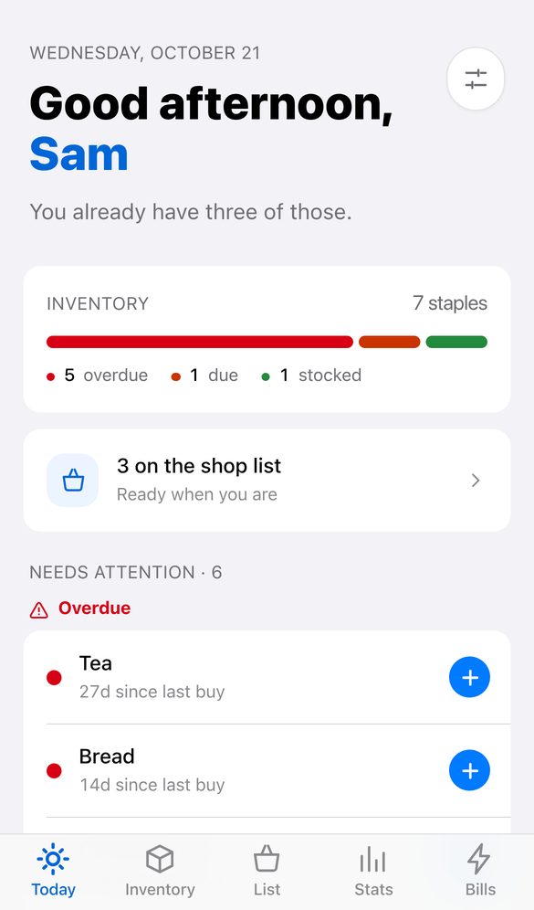
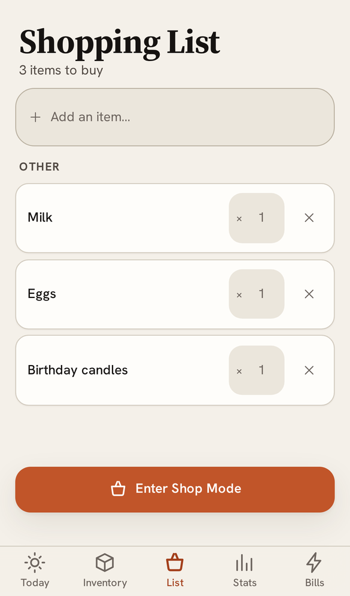
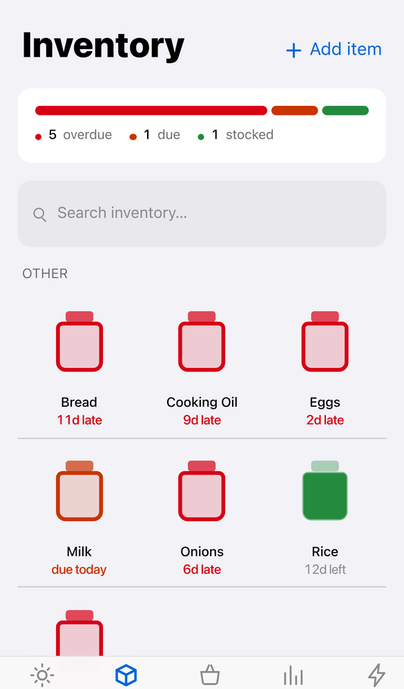
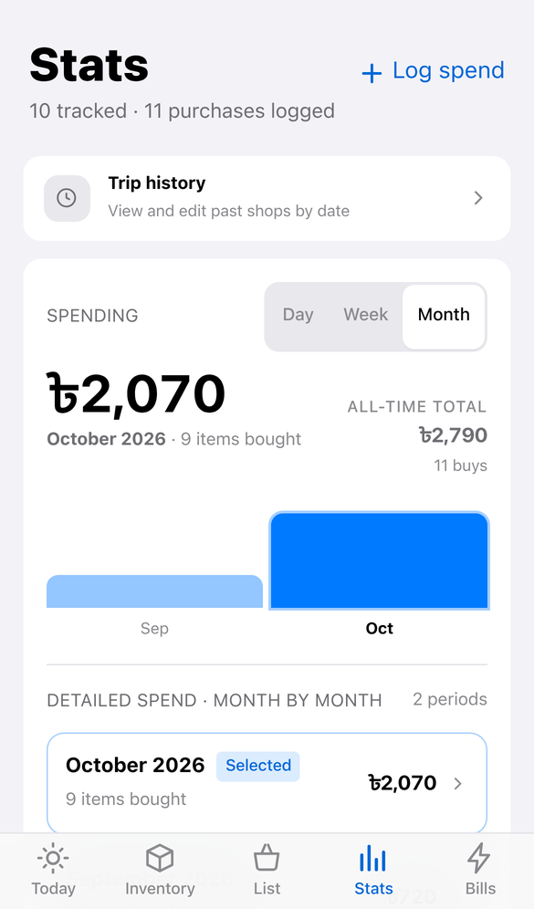
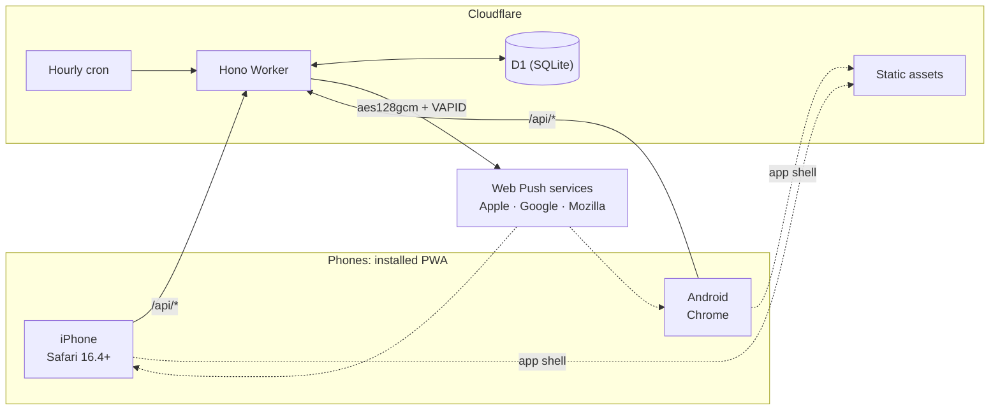

# Pantry

**A shared grocery-restock app for a household.** Pantry learns how quickly you use each
staple, reminds you before it runs out, and keeps one shopping list in sync across
everyone's phones. It works offline in the shop.

It is an installable web app (PWA) for iPhone and Android, running on Cloudflare
Workers and D1.

| Today | Shopping List | Inventory | Stats |
|---|---|---|---|
|  |  |  |  |

---

## Features

- **Learns your rhythm.** Every item gets a restock interval, learned from the median
  gap between real purchases. One bulk buy or one missed week does not throw it off.
- **Reminds you at the right time.** Each person gets a push digest at their own hour,
  on their own days, in their own timezone, outside their own quiet hours.
- **One shared list.** Either person adds to it. Everyone else is notified when something
  is added or bought, with a whole shop rolled into one running notification.
- **Shop Mode.** A full-screen store view in aisle order, with large tap targets, an
  optional price per item, a running total, and the screen kept awake.
- **Works without signal.** The app shell is cached, recent data is kept on the device,
  and actions taken offline are queued and replayed in order when the connection returns.
- **Spending insights.** Spend by category and by day, week or month, plus how fast each
  item is used. Receipt totals can be split across the items they paid for.
- **Bills.** Gas, electricity and wifi are tracked on their own screen, with the same
  learned due dates as groceries. They are paid up front, so they are never added to
  spending or to the month's grocery bill.
- **History and audit log.** Every past shop, grouped by day and correctable afterwards,
  plus an append-only log of every deletion.

---

## How it works

The whole system rests on one decision: **ticking an item off the list is the only data
entry.** There is no separate "log what you used" step, because that is a chore people
stop doing within a week.

That single tap records a purchase. The item's restock clock restarts, its interval is
re-learned from purchase history, and its next due date follows from that. Every
reminder, chart and history entry is a read of those purchase records.



### Restock status

| Status | When |
|---|---|
| `ok` | Well within its interval |
| `due_soon` | Within the member's lead time of the interval |
| `due` | The interval has passed |
| `overdue` | One and a half intervals have passed |

After each purchase, the interval is recalculated as the **median** gap between
purchases. This needs at least three purchases, is clamped to 1–365 days, and is adopted
only if it moves the interval by more than 20%, so normal week-to-week noise doesn't make
it churn. Any item's interval can be locked by hand. A wifi bill, for example, stays at 30
days even when it is paid late.

### Reliability

The places where a silent failure would corrupt data are guarded in the database, not
just in application code:

- **Buying is idempotent.** A double-tap, a retry on poor shop wifi, or an offline action
  replayed later records exactly one purchase. Each write in the buy transaction is
  conditional on the list entry still being pending.
- **Duplicates are impossible, not just unlikely.** Partial unique indexes stop the same
  item, or the same free-text name in any letter case, from sitting on the list twice.
  Item names are unique regardless of case.
- **Offline purchases keep their real time.** A purchase is timestamped when it is tapped,
  not when it syncs, so learned intervals are not skewed by when the signal came back.
- **One bad record cannot silence the household.** Each push subscription, and each
  member in the reminder sweep, is handled in isolation.
- **Deletions leave a trace.** Deleting an item records a snapshot of it and its purchase
  history in the audit log, atomically with the delete.

Design rationale in full: [docs/DESIGN.md](docs/DESIGN.md).

---

## Tech stack

| Layer | Choice |
|---|---|
| Runtime | Cloudflare Workers |
| API | Hono 4 |
| Database | Cloudflare D1 (SQLite) |
| Client | React 19, TypeScript, Vite, Tailwind CSS 4 |
| Push | Web Push via `web-push-neo` (`aes128gcm`, the only encoding iOS accepts) |
| Tests | Vitest with `@cloudflare/vitest-pool-workers`: a real Worker against a real D1 |

There are four runtime dependencies: `hono`, `react`, `react-dom` and `web-push-neo`.
The app uses no chart, component, state or date library.

---

## Getting started

**Requirements:** Node.js 22+ and a Cloudflare account (the free tier is enough).

```bash
npm install
cp .dev.vars.example .dev.vars   # then fill in the values (see Configuration)
npm run db:migrate:local
```

Run the Worker and the client in two terminals:

```bash
npm run dev:worker   # API + local D1 on :8787
npm run dev          # Vite client on :5173, proxying /api to the Worker
```

Open http://localhost:5173. The first run walks you through creating the household.

### Configuration

| Variable | Purpose |
|---|---|
| `SESSION_SECRET` | Signs session cookies. Generate with `openssl rand -base64 32`. |
| `VAPID_PUBLIC_KEY` / `VAPID_PRIVATE_KEY` | The Web Push key pair. Generate once with `web-push-neo`. |
| `VAPID_SUBJECT` | A `mailto:` contact address for push services. |

Use `.dev.vars` locally and `npx wrangler secret put <NAME>` in production. Keep the
VAPID key pair for good: rotating it invalidates every phone's subscription.

### Commands

| Command | |
|---|---|
| `npm test` | Full test suite |
| `npm run typecheck` | `tsc --noEmit` |
| `npm run build` | Production build |
| `npm run deploy` | Build and deploy to Cloudflare |
| `npm run db:migrate:remote` | Apply migrations to the production database |
| `node scripts/render-icons.mjs` | Re-render the app icons from `scripts/icons/` |

---

## Deployment

1. `npx wrangler login`
2. `npx wrangler d1 create pantry-db`, then put the returned `database_id` in `wrangler.jsonc`
3. `npm run db:migrate:remote`
4. Set the four secrets with `npx wrangler secret put`
5. `npm run deploy`

On iPhone, notifications need the app to be added to the Home Screen first (iOS 16.4+).
The full guide is in [docs/DEPLOYMENT.md](docs/DEPLOYMENT.md).

---

## Project structure

```
migrations/          D1 schema and migrations (0001_init.sql is the annotated baseline)
src/
  shared/types.ts    Types shared by the Worker and the client
  worker/
    index.ts         App assembly, fetch and scheduled handlers
    restock.ts       Restock status, interval learning, local-time helpers
    cron.ts          Hourly reminder digest
    activity.ts      Notifications for list adds and purchases
    push.ts          Web Push delivery and dead-subscription pruning
    audit.ts         Audit-log writer
    auth.ts          Passcode hashing and signed sessions
    routes/          auth, items, list, purchases, insights, push, audit
  client/
    screens/         Today, Shopping List, Shop Mode, Inventory, Stats, History, Bills, Settings
    components/      Sheets, tab bar, jars, offline outbox, banners
    lib/             Money, offline queue and cache, date grouping, formatting
public/              PWA manifest, icons, service worker, self-hosted fonts
scripts/             Icon sources and renderer
test/                One file per area, each against an isolated D1
docs/                Design rationale and deployment guide
```

---

## API

All routes are under `/api` and return JSON. Errors have the shape
`{ "error": "snake_case_code", "message": "Human-readable sentence." }`.

*Session* means a signed-in device. *Member* means a profile has also been chosen, which
any action that is attributed to a person requires.

| Method | Path | Requires |
|---|---|---|
| `GET` | `/session` | — |
| `POST` | `/setup` | — (first run only) |
| `POST` | `/login` · `/logout` | — |
| `POST` | `/profile` | session |
| `POST` | `/profile/passcode` | member |
| `GET` | `/items` · `/categories` | session |
| `GET` | `/today` | member |
| `POST` | `/items` | member |
| `PATCH` | `/items/:id` | session |
| `DELETE` | `/items/:id` | member |
| `GET` | `/list` | session |
| `POST` | `/list` | member |
| `PATCH` | `/list/:id` | session |
| `DELETE` | `/list/:id` | member |
| `POST` | `/list/:id/skip` | session |
| `POST` | `/list/:id/bought` | member |
| `GET` | `/purchases` · `/items/:id/purchases` | session |
| `POST` · `PATCH` | `/purchases` | member |
| `DELETE` | `/purchases/:id` | member |
| `GET` | `/insights` · `/audit-log` | session |
| `GET` | `/push/key` | — |
| `POST` | `/push/subscribe` · `/push/test` | member |
| `GET` | `/health` | — |

---

## Security

- There are no user accounts. A household shares one passcode, hashed with PBKDF2-SHA256
  at 100,000 iterations (the most Cloudflare Workers allows) with a random salt. The
  household owner's profile can carry a second passcode of its own.
- Sessions are HMAC-signed, `HttpOnly` cookies.
- Every query is scoped to the household and uses bound parameters.
- Secrets are never committed: `.dev.vars` is git-ignored, and production secrets live in
  Wrangler's secret store.

---

## Known limitations

- Reminder settings (hour, days, quiet hours, lead time) are honoured but cannot yet be
  edited from the app.
- The currency symbol is fixed to ৳ (BDT).
- Categories and aisle order are set at setup and cannot yet be changed in the app.
- One household per deployment.

---

## Credits

Designed and built by **Mahmudul Khan** · [mahmudulkhan.com](https://www.mahmudulkhan.com)

Released under the [MIT License](LICENSE).
